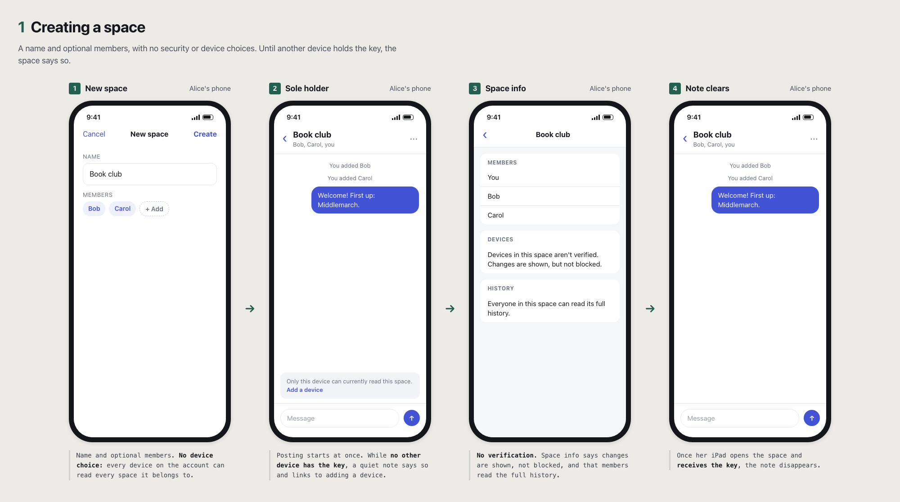
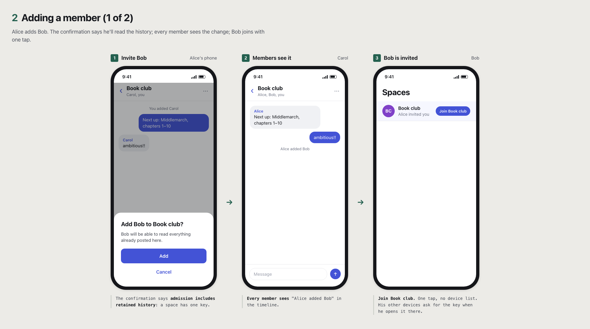
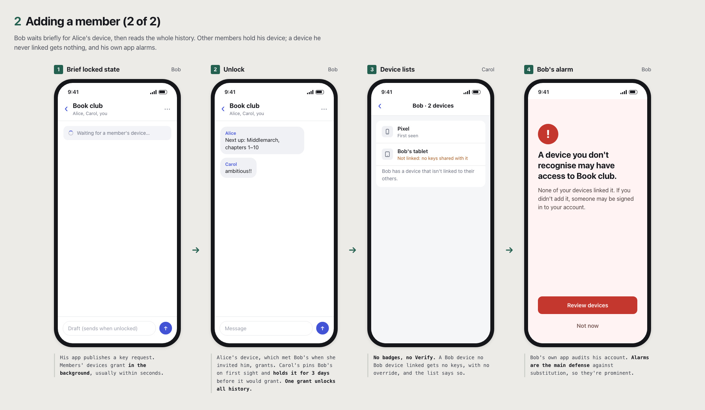
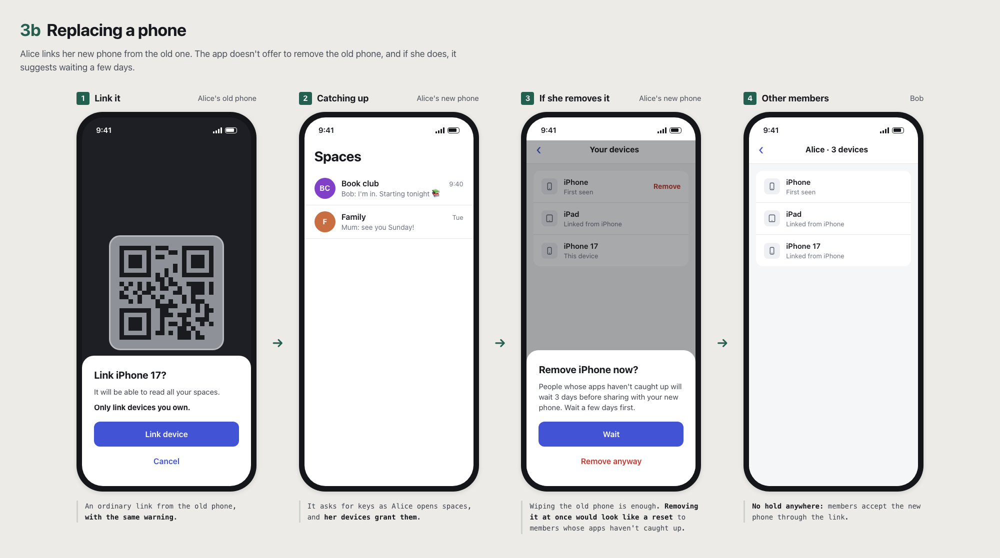
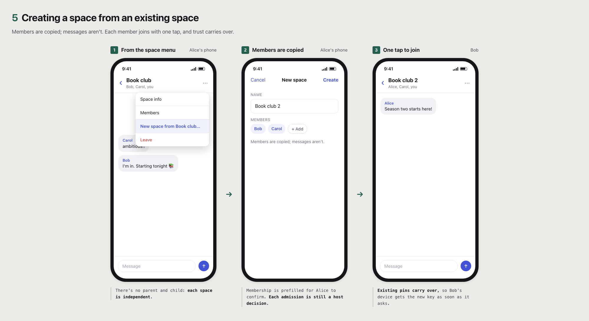
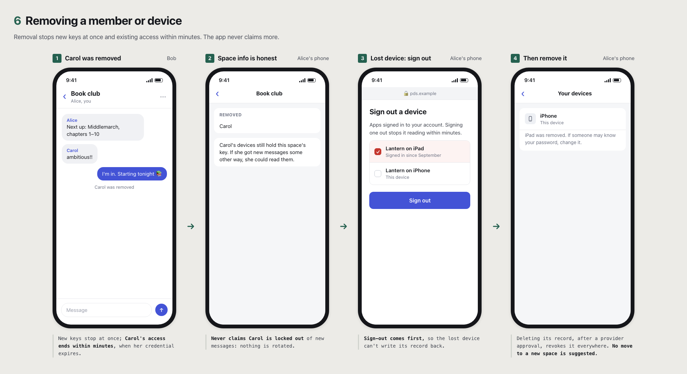
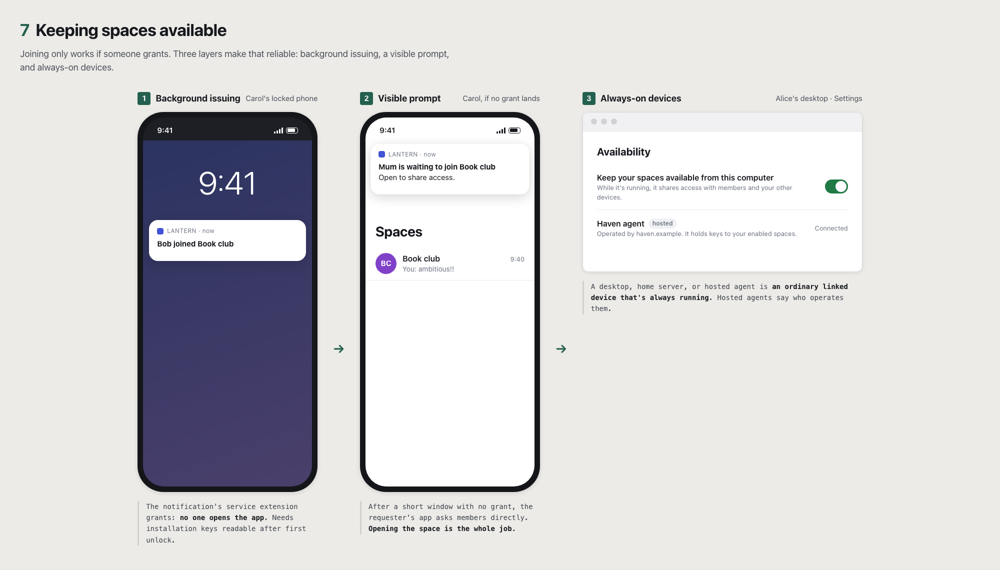

# NBD UX Flows: Paranoid

Informative. User-facing flows for NBD spaces, which all use [trust on first use](../core.md#device-trust). See also [Relaxed](relaxed.md), which presents the same protocol with minimal security UI. A "device" is an app installation.

## What protects these spaces

A person's devices are trusted on first contact; after that, a new device is accepted only if one of that person's existing devices linked it ([local trust](../device-enrollment.md#local-trust)). A malicious PDS, or someone who has taken over the account, can substitute keys at first contact, including for people who first meet an account right after it was hijacked; a substituted device that any member accepts can read the whole space. The defense there is detection after the fact, through [auditing](../audit.md#direct-sync) of grants to your own account. Devices are removed by deleting them from your account, which takes a separate approval at your provider. Your app's everyday access can't delete devices, so a stolen device running it can't remove your others, unless the thief also has your password, the device is still signed in to your provider in its browser, or the provider ignores app permissions ([revocation authority](../device-enrollment.md#revocation-authority)). Whoever can remove all your devices can enroll a new one, which is also how you recover from losing everything, but people who already knew you wait at least 72 hours ([hold](../device-enrollment.md#re-enrollment)), and members and your own devices are told about it. The wait is kept by those people's apps; a member who never knew you treats the new device as a first contact and can share a space with it at once. First contact works as in Signal, but a leaked key exposes more here: there is no forward secrecy, and removal doesn't lock anyone out cryptographically ([security goals](../README.md#goals)).

There is no device verification. Members share one key, so one member verifying another would not protect the space: anyone who accepted a substituted device could pass it the key ([why](../core.md#device-trust)). Verified-only spaces are a [deferred extension](../TODOs.md#deferred-extensions). Space info says: "Devices in this space aren't verified. Changes are shown, but not blocked."

## UI vocabulary

- **Device list** per member: each device and when it was added. No trust badges and no Verify action.

## Creating a space

1. **"New space" form:** name and optional members. No security choices.
2. **No device choice.** Every device on the account can read every space the account belongs to ([approvals](../device-enrollment.md#approvals)), so creating asks nothing about devices.
   - *Under the hood:* the host stores configuration revision 1 and the creator's eligible membership decision. On the app's first NBD use, it generates keypairs and publishes its [device record](../device-enrollment.md#bindings-and-publication).
3. **No extra wait.** The space key is generated on this device before the space is created, and its [commitment](../core.md#key-generation) is part of the creating configuration, so posting can start as soon as creation succeeds.
4. **Space opens.** The creator's other devices get the key when they open it; installations of the same app get it right away.

**Sole-holder indicator:** whenever this device is the only known holder of the space key (it has seen no grant of that key to any other binding), show a quiet note: "Only this device can currently read this space." It disappears once another device or member receives the key and links to "Add a device".

## Adding a member

Admin Alice adds Bob.

**Alice:**

1. **Invite Bob.** The confirmation explains that admission includes retained history: "Bob will be able to read everything already posted here." This is [recommended](../core.md#trusted-host-state), and space info also states it; a space has [one key](../core.md#key-generation), so past content is part of membership.
2. **Every member sees "Alice added Bob"** in the timeline.

**Bob:**

3. **Notification, then "Join Book club."** One tap, no device list. His other devices request the key when he opens the space on them.
4. **Brief locked state: "Waiting for a member's device…"** His app publishes a [key request](../core.md#key-requests). Bob can write drafts locally. Members' devices grant [in the background](#keeping-spaces-available), usually within seconds.
5. **Unlock.** Carol's device pins Bob's device on first sight and grants; Bob's device pins Carol's device and accepts. One grant unlocks all reachable history.

**Afterwards:**

6. **Device lists:** each sees the other's devices, with no badges or Verify action.
7. **Unlinked devices:** if a new Bob device appears without a link from a Bob device already pinned, members' apps don't share keys with it, and there is no override. Device lists show "Bob has a device that isn't linked to his others," which can mean Bob skipped linking or someone is impersonating him.
8. **Alarms:** Bob's client alarms if it finds a grant to a device he never approved, or records in his repo for devices he doesn't recognise ([auditing](../audit.md#direct-sync)): "A device you don't recognise may have access to *Book club*." These are the main defense against substitution, so they are prominent.

## Adding a device

Alice gets a new laptop.

1. **Laptop:** install, log in, show "Link this device" with a QR code. Until it is linked, members' apps that already know Alice won't share keys with it ([local trust](../device-enrollment.md#local-trust)); the screen says so.
2. **Phone:** Devices → Link → scan, then one confirmation: "Link *Alice's Laptop*? It will be able to read all your spaces. Only link devices you own." The phone signs an [approval](../device-enrollment.md#approvals); there is no list of spaces.
3. **Pairing transfers [private state](../device-enrollment.md#backup-and-transfer):** pins move to the laptop so it does not pin everyone afresh. Afterwards each device pins on its own.
4. **Spaces open on demand.** When Alice opens a space on the laptop, it requests the key and her phone grants it in the background; the laptop reads full history. Installations of the same app may get keys right away.
5. **Other members:** the laptop is approved by Alice's phone, so they accept it. No timeline notice; device lists show "Alice · 3 devices".
6. **Alice's other devices notify her:** "New device: *Alice's Laptop*, added from *iPhone*, 2 minutes ago. Not you? Remove it." One notice per device, none on the approving phone. **Remove it** first sends Alice to her provider's settings to sign the laptop out, so it can't write to her account; it loses access to spaces within minutes. The app then asks her to approve removal at her provider and deletes the laptop from her account, which [revokes](../device-enrollment.md#device-revocations) it: it gets no new keys but keeps those it already received. The app checks the deletion stuck and, if the laptop reappeared, deletes it again and warns that something else still has access. The notice also suggests changing her password, and lists any devices the laptop itself linked so she can remove those too. If the laptop is gone but someone kept its keys, more devices can appear until every session is signed out and the password changed, so the notice says so. A device Alice never approved means her account or PDS may be compromised, so this notice, unlike an ordinary device removal, also offers to move affected spaces ([own-account notices](../audit.md#direct-sync), [no rotation](../core.md#no-rotation)).

7. **Replacing a phone.** If the laptop replaces an old device, the app does not offer to remove the old one afterwards. Wiping or trading it in is fine. Removing it from her account right away would make members' apps that haven't caught up see a reset and wait 3 days ([replacement](../device-enrollment.md#replacement)), so if Alice removes it, the app suggests waiting a few days first.

## Losing every device

1. **"Restore from backup"** (same keys and state) is instant. Without a backup, the app offers **Start over on this device** ([total device loss](../device-enrollment.md#total-device-loss)).
2. **Remove the old devices.** The app lists every other device on Alice's account, with its name and when it was added, and asks whether she recognises them all. If she still has one, it sends her to link from it instead, which needs no wait. If she doesn't recognise one, it says her account may have been compromised and to change her password first. It then asks her to approve removal at her provider and deletes them all. The new device can't be linked, so this is the only way in. It doesn't raise "A device you don't recognise" for her old devices, since it can't tell them from anyone else's; the list is where she checks them. Keys her old devices received appear in member access as received before she started over. A device still on her account after the removal, or added later, raises the alarm ([auditing](../audit.md#direct-sync)).
3. **People who knew Alice wait at least 72 hours.** Once no old devices remain, the app says: "People who already know you will wait at least 3 days before sharing with this device. This gives you time to stop someone who got into your account." It can't promise a time, or that nobody shares sooner: each member's app starts its own wait when it first sees the new device, so an app that was offline starts later, and a member whose app never knew Alice sees an ordinary first contact, doesn't wait, and can unlock a space for her at once ([security goals](../README.md#goals)). Each space shows its own status ("Waiting for members", then "Unlocked"). Members who knew Alice see "Alice reset her devices. This device will share with her new device from Friday," with the time their own app computed; their app can't shorten its own wait.
4. **History mostly returns** after the hold: members re-grant keys they hold. Messages only Alice's lost devices held are gone.
5. **If Alice didn't do this,** any old device of hers that is still running alarms as soon as it sees itself removed: "This device was removed from your account. If this wasn't you, change your password at your provider and remove devices you don't recognise." Removing the new device there cancels the hold ([re-enrollment](../device-enrollment.md#re-enrollment)).
6. **Prevention still matters.** The app prompts users with one device to add a second device or turn on backup, so recovery doesn't need the wait.

## Creating a space from an existing space

NBD has no parent/child relationship; each space is cryptographically independent. This is also how a group leaves a space it credibly believes is compromised beyond what the host can stop ([replacing a space](../core.md#replacing-a-space)); it is not a response to [removing a member](#removing-a-member-or-device).

| Carries over | Doesn't carry over |
| --- | --- |
| [Device trust](../device-enrollment.md#local-trust): TOFU pins. | Membership: each admission is a separate host decision (the app can prefill it). |
| Public device records and approvals. | |
| | Keys and history: the new space has its own key; parent content is not readable through it. |

1. **"New space from Book club…"** prefills the parent's members. Copy: "Members are copied; messages aren't."
2. **Creator:** as in [creating a space](#creating-a-space).
3. **Each member taps Join once;** existing pins carry over, so grants arrive as soon as their devices request them.

## Removing a member or device

1. **Removal stops new keys at once.** Removing Carol from Book club takes effect as soon as members' apps and the host learn of it: no new grants to her devices, and the host stops issuing her access. Access she already has expires within minutes, an hour at most ([ending access](../core.md#ending-access)). Nothing is held back; posting continues.
2. **Removing a device takes two steps, sign-out first.** "Remove device" sends Alice to her provider's settings to sign *Alice's Laptop* out, after which its access ends within minutes ([ending access](../core.md#ending-access)) and it can no longer write to her account. The app then asks her to approve removal at her provider and deletes the laptop from her account, which [revokes](../device-enrollment.md#device-revocations) it; new keys stop as soon as members' apps see the deletion. The app confirms the laptop stays deleted, and deletes it again with a warning if it comes back ([removal order](../device-enrollment.md#revocation-authority)). The confirmation adds: "If someone may know your password, change it." The app's everyday access can't delete devices, so a stolen device can't remove Alice's others without her password or a browser on it that is still signed in to her provider.
3. **Copy is honest.** The timeline says "Carol was removed," never that new messages are protected from her. Space info explains: "Carol's devices still hold this space's key. If she got new messages some other way, she could read them" ([no rotation](../core.md#no-rotation)).
4. **No move offered.** Removing, plus signing a device out, is the whole response; the notice does not suggest a new space. Moving lives in space settings for groups that credibly believe the space is compromised beyond what the host can stop ([replacing a space](../core.md#replacing-a-space)).

## Keeping spaces available

1. **Background issuing.** Key requests trigger push notifications to members' devices, which grant without the app being opened ([distribution](../core.md#distribution-scheduling)). On iOS, the visible "Bob joined Book club" notification's service extension does the work, which requires installation keys readable after first unlock ([platform notes](../device-enrollment.md#platform-notes)).
2. **Visible prompts.** If no grant arrives within a short window, the requester's app asks members to open the space: "Bob is waiting to join Book club. Open to share access."
3. **Always-on devices.** A desktop, home server, or hosted agent linked as an ordinary device grants whenever it is running. Settings copy: "Keep your spaces available from this computer." Hosted agents say who operates them, because they hold keys.

