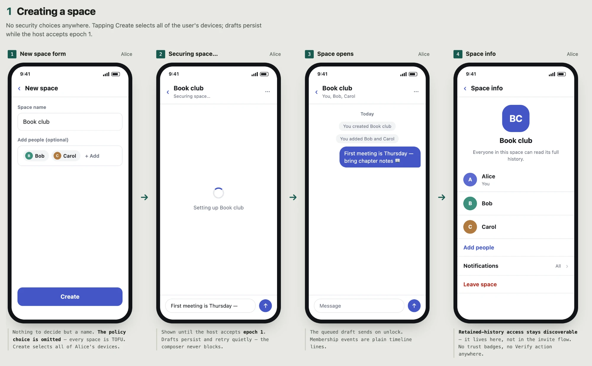
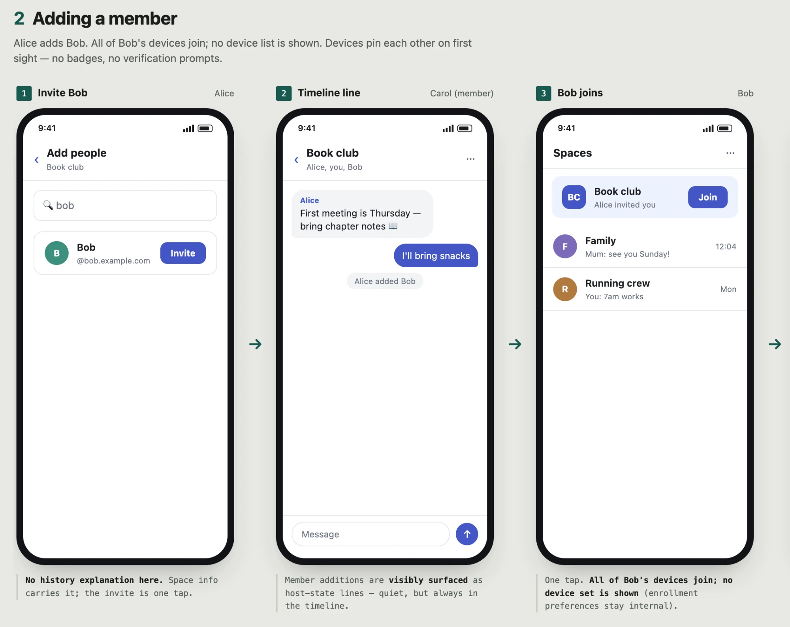
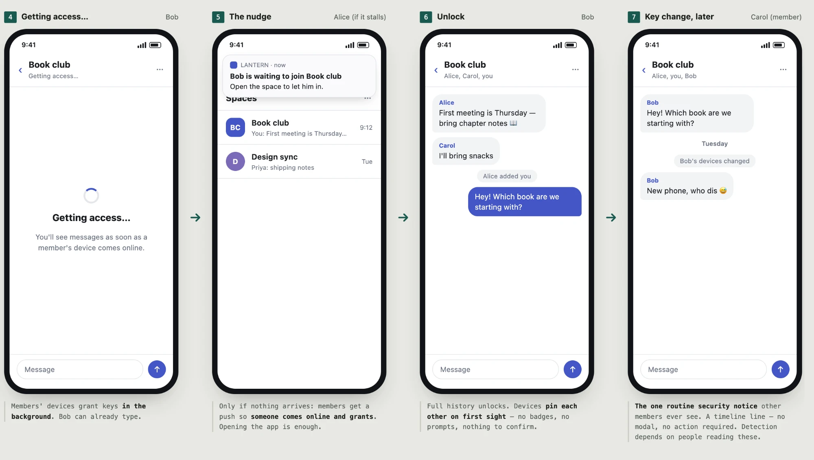
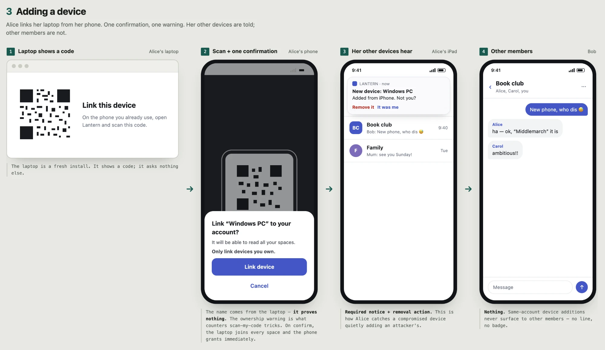
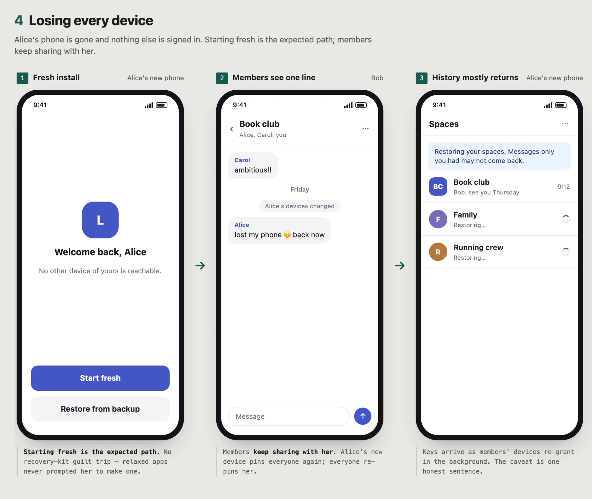
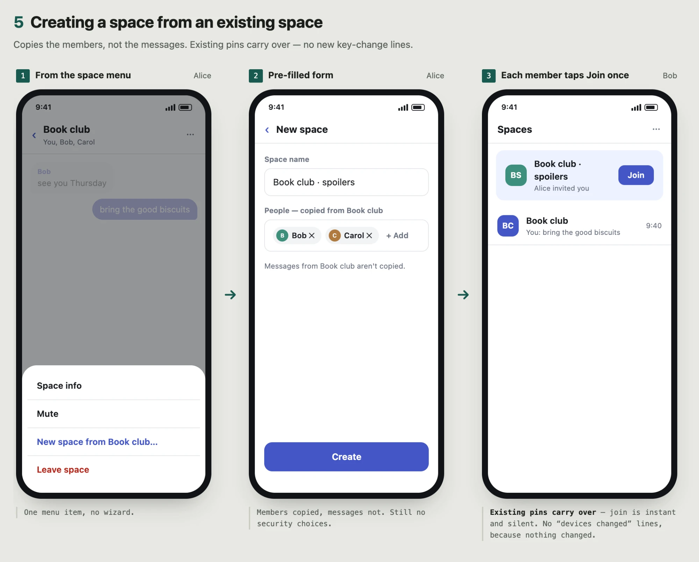
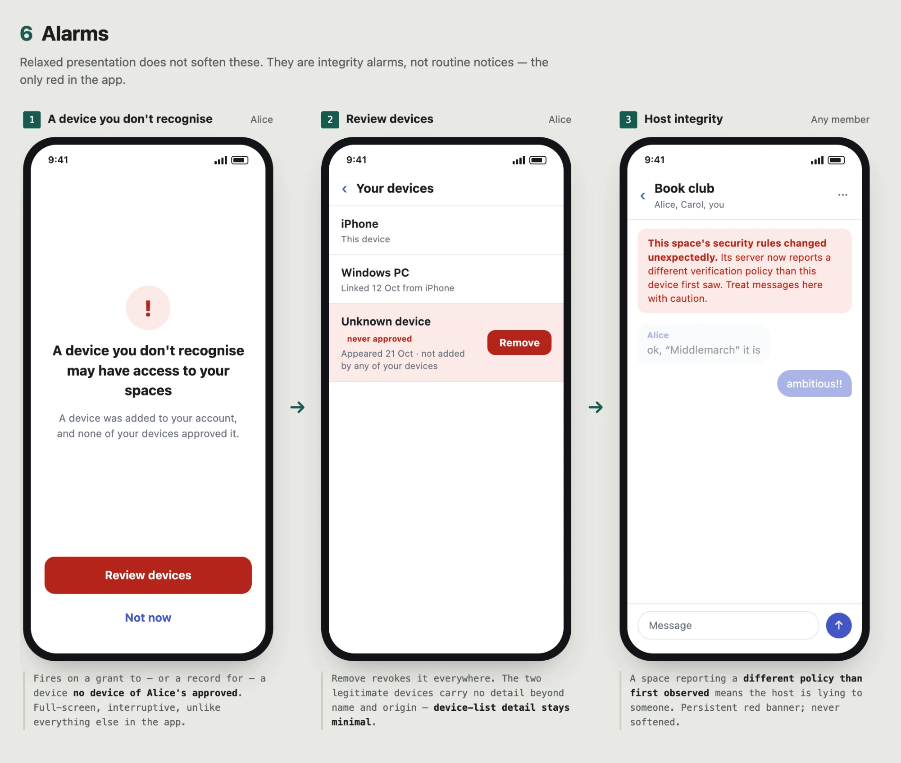
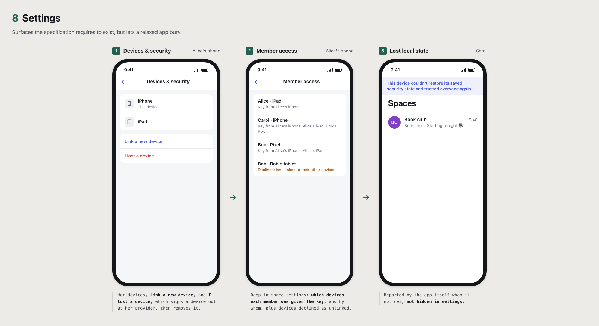

# PEEP UX Flows: Relaxed TOFU

Informative. A presentation of [TOFU](tofu.md) spaces (`tofu` [policy](../core.md#device-verification-policy)) with the minimum user-facing security process the specification allows. The protocol is unchanged: relaxed and full TOFU clients interoperate in the same spaces. See also [Verified-only](verified-only.md). A "device" is an app installation.

## What protects these spaces

The same as [TOFU](tofu.md#what-protects-these-spaces): devices are trusted on first use, unapproved changes are accepted as visible [TOFU key changes](../device-enrollment.md#local-trust), and the defense against a malicious PDS is detection through [auditing](../audit.md#direct-sync) and notices. Relaxed presentation keeps every required notice but makes routine ones quiet, so detection depends more on users noticing timeline lines and on the account holder's own alarms.

## Flows

### Creating a space

1. **"New space" form:** name and optional members. No security choices.
2. **Space opens** as soon as it is created; the key is generated on this device first. Space info includes "Everyone in this space can read its full history."

### Adding a member

Alice adds Bob.

1. **Invite Bob.** No history explanation; space info carries it.
2. **Timeline:** "Alice added Bob."
3. **Bob taps "Join Book club".** No device list is shown.
4. **Bob waits briefly:** "Getting access…" while members' devices grant [in the background](tofu.md#keeping-spaces-available). If nothing arrives, members get "Bob is waiting to join Book club."
5. **Unlock.** Devices pin each other on first sight. No badges, no verification prompts.
6. **Key changes appear as a timeline line:** "Bob's devices changed." No modal, no action required. This is the one routine security notice other members see.

### Adding a device

1. **Laptop:** "Link this device" with a QR code.
2. **Phone:** scan, then one confirmation: "Link *Windows PC* to your account? It will be able to read all your spaces. Only link devices you own." The name is reported by the laptop and is not proof of anything; the warning is what counters tricks to scan an attacker's code. The laptop can read every space; it requests keys as Alice opens them, and the phone grants in the background.
3. **Alice's other devices:** "New device: *Windows PC*. Added from iPhone. Not you?" with **Remove it** and **It was me**. This notice and its removal action are required; they are how Alice catches a compromised device adding an attacker's. **Remove it** also tells her to sign the device out at her provider and change her password.
4. **Other members:** nothing.

### Losing every device

1. **"Restore from backup"** or **"Start fresh"**. Starting fresh is the expected path.
2. **Members see "Alice's devices changed"** and keep sharing with her. Alice's new device pins everyone again.
3. **History mostly returns** as members re-grant keys. Copy: "Messages only you had may not come back."

### Creating a space from an existing space

"New space from Book club…" copies the members, not the messages. Each member taps Join once, and existing pins carry over.

### Removing a member or device

Removal and **I lost a device** stop new keys at once, with nothing held back, and existing access expires within minutes ([ending access](../core.md#ending-access)). **I lost a device** also tells the user to sign the device out at their provider, since the app can't, and suggests changing their password. The timeline says "Carol was removed," and space info adds that her devices still hold the space's key ([no rotation](../core.md#no-rotation)). The notice does not suggest moving to a new space.

### Alarms

Relaxed presentation does not soften these. They are integrity alarms, not routine notices:

- **A device you don't recognise:** a grant to, or a record for, a device of the user's account that no device of theirs approved ([auditing](../audit.md#direct-sync)). Copy: "A device you don't recognise may have access to your spaces. Review devices."
- **Host integrity:** a space reporting a different verification policy than first observed ([policy](../core.md#device-verification-policy)).

### Settings

Surfaces the specification requires to exist but allows to be buried:

- **Devices & security:** the user's devices, **Link a new device**, and **I lost a device**, which removes a lost device: it revokes the binding, so the device gets no new keys, and tells the user to sign it out at their provider so it stops reading.
- **Member access**, deep in space settings: the devices each member has been granted keys to, as observed by this user's devices, with who granted them and when, including accepted key changes ([auditing](../audit.md#direct-sync)).
- **Lost local state** is reported by the app itself when it detects it, not from settings: for example, after a reinstall without restore, "This device couldn't restore its saved security state and trusted everyone again" ([recovery](../device-enrollment.md#recovery)).

## What stays and what goes

| Still required | Omitted or hidden |
| --- | --- |
| Member additions, removals, readmissions, and accepted TOFU key changes are visibly surfaced ([host state](../core.md#trusted-host-state)). | Policy choice at creation: every space is TOFU. |
| Retained-history access is discoverable, here in space info ([host state](../core.md#trusted-host-state)). | The history explanation when inviting. |
| Linking confirms adding a device, with an access warning ([approvals](../device-enrollment.md#approvals)). | |
| Own-account device notices with removal, and alarms for devices the account never approved ([auditing](../audit.md#direct-sync)). | |
| Telling the user to sign a removed device out at their provider ([ending access](../core.md#ending-access)). | |
| A way to inspect observed grants to any member ([auditing](../audit.md#direct-sync)), which can live deep in settings. | The sole-holder indicator and device-list detail. |
| Reporting known loss of local state ([recovery](../device-enrollment.md#recovery)). | |
| Never claiming a removal locks the removed party out of new messages ([no rotation](../core.md#no-rotation)). | |

