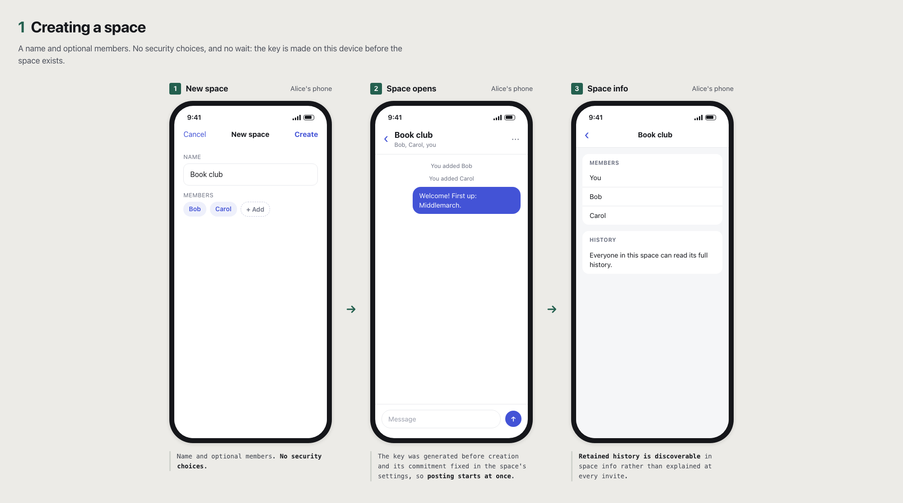
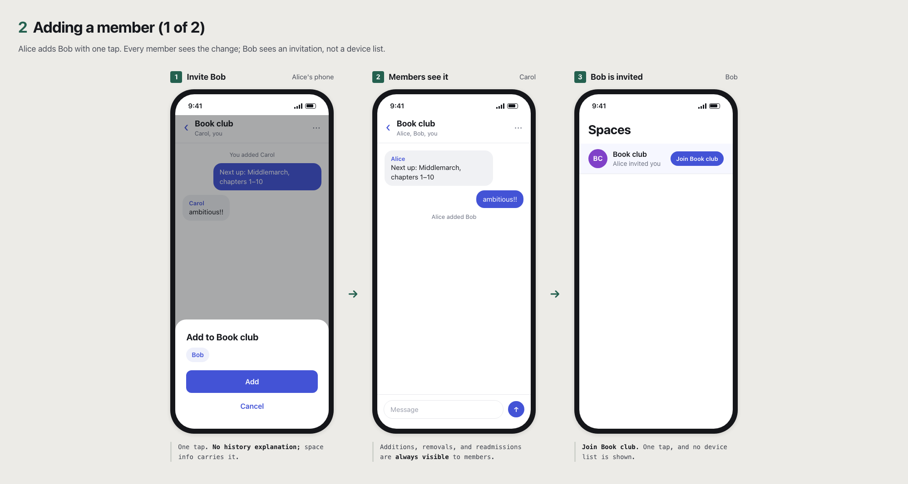
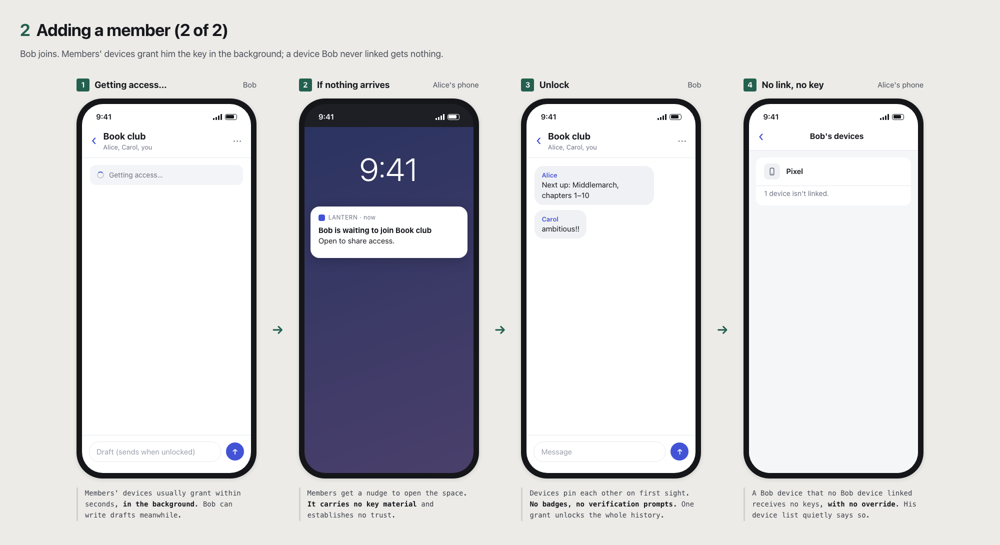
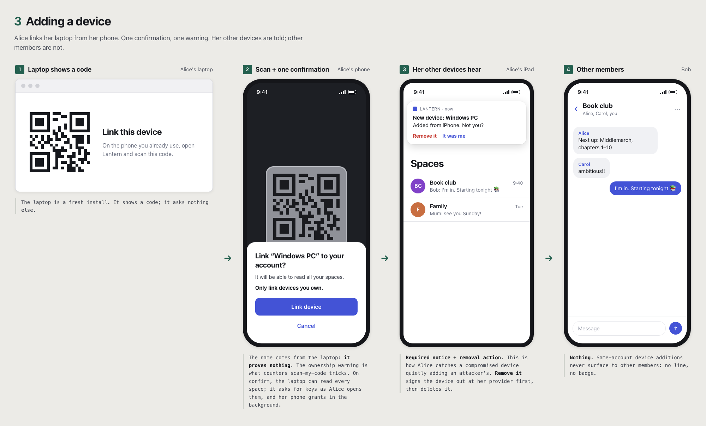
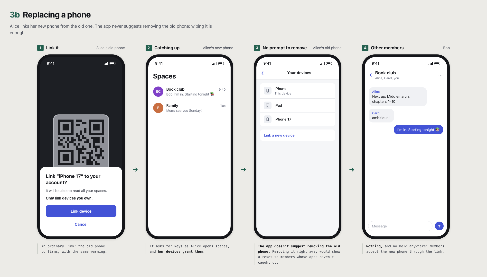
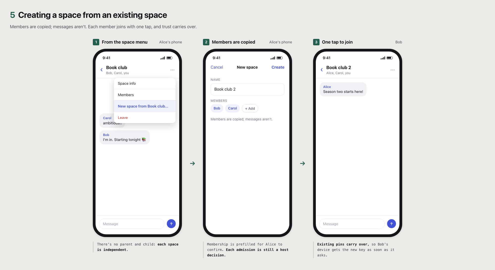
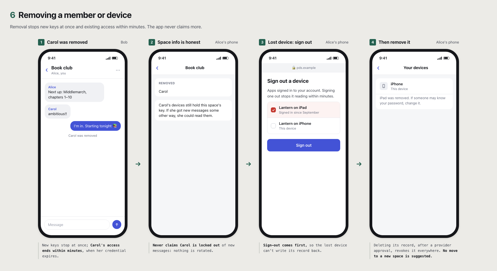
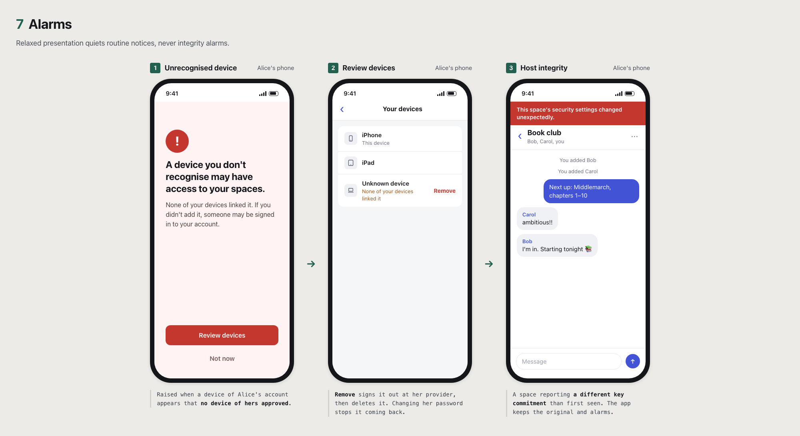
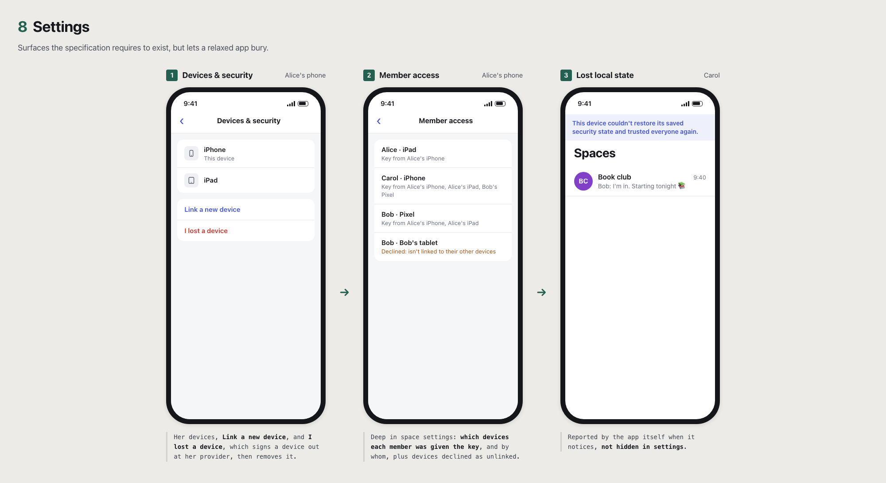

# NBD UX Flows: Relaxed

Informative. A presentation of the same NBD spaces as the [Paranoid](paranoid.md) flows, with the minimum user-facing security process the specification allows. The protocol is unchanged: relaxed and paranoid clients interoperate in the same spaces. A "device" is an app installation.

## What protects these spaces

The same as [Paranoid](paranoid.md#what-protects-these-spaces): devices are trusted on first contact, later devices must be [linked](../device-enrollment.md#local-trust), removing a device takes a separate approval at the provider, and the defense against first-contact substitution by a malicious PDS is detection through [auditing](../audit.md#direct-sync). Relaxed presentation keeps every required notice but makes routine ones quiet, so detection depends more on the account holder's own alarms.

## Flows

### Creating a space

1. **"New space" form:** name and optional members. No security choices.
2. **Space opens** as soon as it is created; the key is generated on this device first. Space info includes "Everyone in this space can read its full history."

### Adding a member

Alice adds Bob.

1. **Invite Bob.** No history explanation; space info carries it.
2. **Timeline:** "Alice added Bob."
3. **Bob taps "Join Book club".** No device list is shown.
4. **Bob waits briefly:** "Getting access…" while members' devices grant [in the background](paranoid.md#keeping-spaces-available). If nothing arrives, members get "Bob is waiting to join Book club."
5. **Unlock.** Devices pin each other on first sight. No badges, no verification prompts.
6. **Unlinked devices get nothing.** A new Bob device that no Bob device linked receives no keys, with no override; his device list quietly notes "1 device isn't linked."

### Adding a device

1. **Laptop:** "Link this device" with a QR code.
2. **Phone:** scan, then one confirmation: "Link *Windows PC* to your account? It will be able to read all your spaces. Only link devices you own." The name is reported by the laptop and is not proof of anything; the warning is what counters tricks to scan an attacker's code. The laptop can read every space; it requests keys as Alice opens them, and the phone grants in the background.
3. **Alice's other devices:** "New device: *Windows PC*. Added from iPhone. Not you?" with **Remove it** and **It was me**. This notice and its removal action are required; they are how Alice catches a compromised device adding an attacker's. **Remove it** sends her to sign the device out at her provider, then asks her to approve removal there and deletes the device, which revokes it, checks that it stays deleted, and suggests changing her password.
4. **Other members:** nothing.
5. **Replacing a phone:** the app doesn't suggest removing the old device afterwards; wiping it is enough. Removing it right away would show a reset to members whose apps haven't caught up ([replacement](../device-enrollment.md#replacement)).

### Losing every device

1. **"Restore from backup"** or **"Start over"** ([total device loss](../device-enrollment.md#total-device-loss)).
2. **Starting over:** the app asks the user to approve removal at their provider and deletes the old devices, then shows "People who already know you will wait at least 3 days before sharing with this device," with each space's status as members' apps catch up. A member who never knew the user may share sooner. Members see a quiet line: "Alice reset her devices. This device will share with her new device from Friday." The removal list is where the user checks their old devices; the app doesn't raise unrecognised-device alarms for them, but still does for any device that remains or appears afterwards.
3. **The hold is not softened.** Relaxed apps can't skip or shorten their own [72-hour wait](../device-enrollment.md#re-enrollment), and an old device that sees itself removed still alarms.

### Creating a space from an existing space

"New space from Book club…" copies the members, not the messages. Each member taps Join once, and existing pins carry over.

### Removing a member or device

Removal and **I lost a device** stop new keys at once, with nothing held back, and existing access expires within minutes ([ending access](../core.md#ending-access)). **I lost a device** sends the user to sign the device out at their provider, then asks them to approve removal there and deletes the device, which revokes it, checks that it stays deleted, and suggests changing their password: until they do, whoever kept the lost device's keys can add more devices. The timeline says "Carol was removed," and space info adds that her devices still hold the space's key ([no rotation](../core.md#no-rotation)). The notice does not suggest moving to a new space.

### Alarms

Relaxed presentation does not soften these. They are integrity alarms, not routine notices:

- **A device you don't recognise:** a grant to, or a record for, a device of the user's account that no device of theirs approved ([auditing](../audit.md#direct-sync)). Copy: "A device you don't recognise may have access to your spaces. Review devices."
- **Host integrity:** a space reporting a different key commitment than first observed ([host state](../core.md#trusted-host-state)).

### Settings

Surfaces the specification requires to exist but allows to be buried:

- **Devices & security:** the user's devices, **Link a new device**, and **I lost a device**, which sends the user to sign a lost device out at their provider so it stops reading, then deletes it after they approve removal there so it gets no new keys.
- **Member access**, deep in space settings: the devices each member has been granted keys to, as observed by this user's devices, with who granted them and when, and devices declined as unlinked ([auditing](../audit.md#direct-sync)).
- **Lost local state** is reported by the app itself when it detects it, not from settings: for example, after a reinstall without restore, "This device couldn't restore its saved security state and trusted everyone again" ([recovery](../device-enrollment.md#recovery)).

## What stays and what goes

| Still required | Omitted or hidden |
| --- | --- |
| Member additions, removals, and readmissions are visibly surfaced ([host state](../core.md#trusted-host-state)). | |
| Retained-history access is discoverable, here in space info ([host state](../core.md#trusted-host-state)). | The history explanation when inviting. |
| Linking confirms adding a device, with an access warning ([approvals](../device-enrollment.md#approvals)). | |
| Own-account device notices with removal, and alarms for devices the account never approved ([auditing](../audit.md#direct-sync)). | |
| Signing devices out at the provider, then removing them through a provider approval ([ending access](../core.md#ending-access)). | |
| The re-enrollment hold, its member notice, and the alarm on a removed device ([re-enrollment](../device-enrollment.md#re-enrollment)). | |
| A way to inspect observed grants to any member ([auditing](../audit.md#direct-sync)), which can live deep in settings. | The sole-holder indicator and device-list detail. |
| Reporting known loss of local state ([recovery](../device-enrollment.md#recovery)). | |
| Never claiming a removal locks the removed party out of new messages ([no rotation](../core.md#no-rotation)). | |

