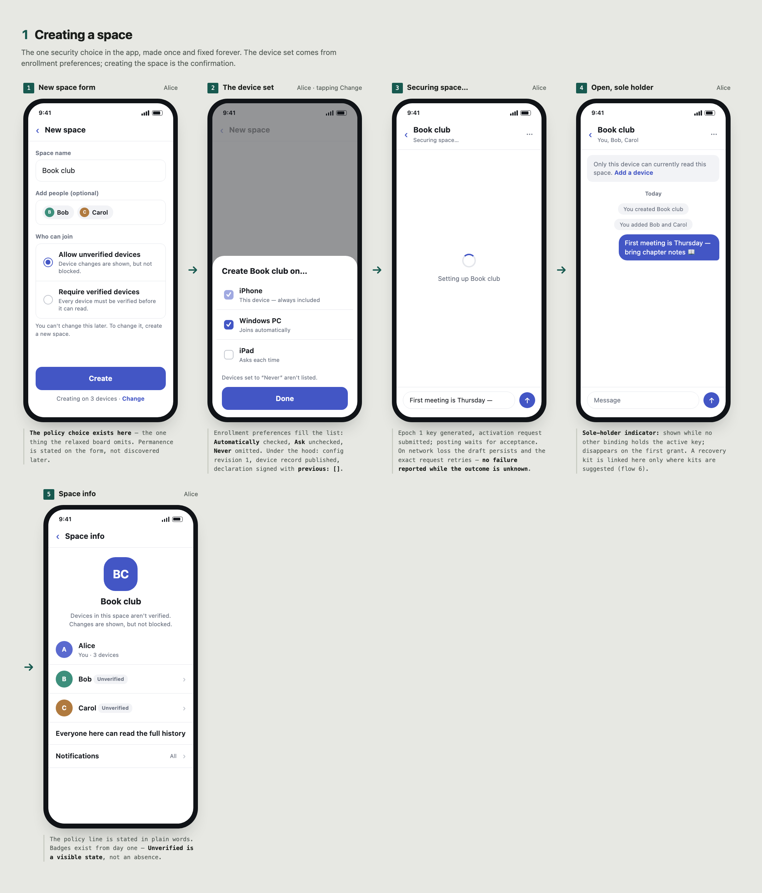
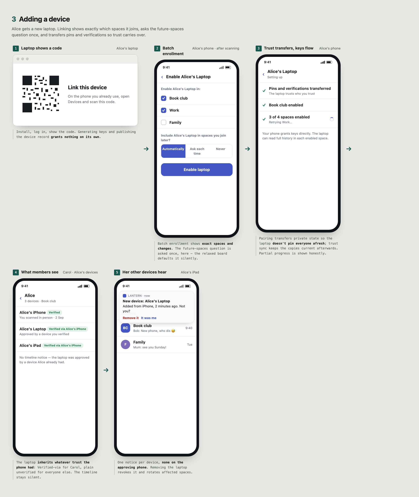
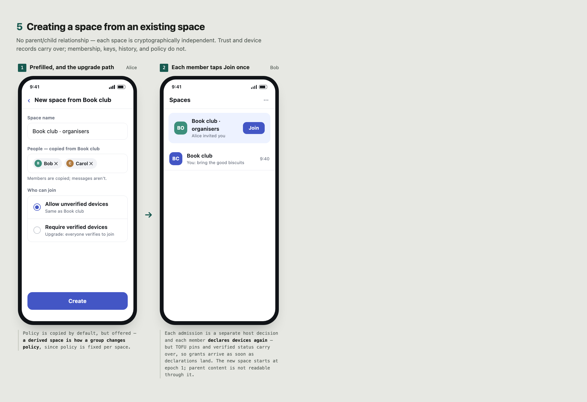
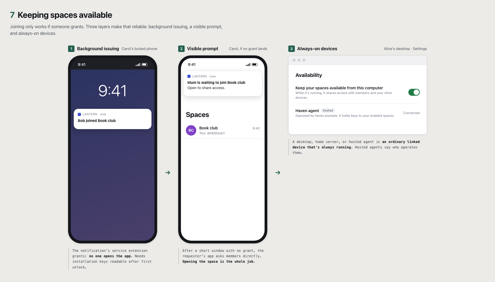

# PEEP UX Flows: TOFU

Informative. User-facing flows for spaces whose [verification policy](../core.md#device-verification-policy) is `tofu-permitted`, with verification available as an option. See also [Verified-only](verified-only.md) and [Relaxed TOFU](relaxed-tofu.md), which presents the same policy with minimal security UI. A "device" is an app installation.

## What protects these spaces

Devices are trusted on first use, and later unapproved changes are accepted as visible [TOFU key changes](../device-enrollment.md#local-trust). A malicious PDS can substitute keys; the defense is detection, through [auditing](../audit.md#direct-sync) of grants to your own account and notices of every unapproved change. Members can verify each other at any time, and verified relationships are binding even here: changes to a verified person's devices block until re-verified.

The policy is chosen at creation and [fixed for the life of the space](../core.md#device-verification-policy). Space info says: "Devices in this space aren't verified. Changes are shown, but not blocked."

## UI vocabulary

- **Space policy:** *Allow unverified devices* (the default).
- **Trust badge** per device: *Unverified*, *Verified*, or *Verified via \<their other device\>* (approval-derived).
- **Verify:** an optional action with three channels: scan in person, share a 6-digit code, or send a link.

## Creating a space

1. **"New space" form:** name, optional members, and *Allow unverified devices* / *Require verified devices*. The form says the choice is permanent: "You can't change this later. To change it, create a new space."
2. **"Creating on 3 devices · Change."** The device set comes from each device's [enrollment preference](../device-enrollment.md#enrollment-preferences): *Automatically* devices are included, *Ask* devices appear unchecked, *Never* devices are omitted. This device is always included. Creating the space is the confirmation.
   - *Under the hood:* the host stores configuration revision 1 and the creator's eligible membership decision. On the app's first PEEP use, it generates keypairs and publishes its [device record](../device-enrollment.md#bindings-and-publication). It signs the initial [declaration](../device-enrollment.md#declarations) with `previous: []`.
3. **"Securing space…":** the epoch 1 key is generated and the [activation request](../core.md#client-activation-states) submitted. Posting waits for acceptance. On network loss, the draft persists and the exact request is retried; the UI does not report failure while the outcome is unknown.
4. **Space opens.** The creator's other devices receive grants in the background.

**Sole-holder indicator:** whenever this device is the only known holder of the active key (it has seen no grant of that key to any other binding), show a quiet note: "Only this device can currently read this space." It disappears once another device or member receives the key and links to "Add a device".

## Adding a member

Admin Alice adds Bob.

**Alice:**

1. **Invite Bob.** The confirmation explains that admission includes retained history: "Bob will be able to read everything already posted here." This is [recommended](../core.md#trusted-host-state), and space info also states it; [history wrapping](../core.md#backward-history-wrapping) makes past content part of membership.
2. **Every member sees "Alice added Bob"** in the timeline.

**Bob:**

3. **Notification, then "Join Book club" with "Joining on 3 devices · Change."** One tap. His [enrollment preferences](../device-enrollment.md#enrollment-preferences) choose the devices, and this device signs one declaration for all of them.
4. **Brief locked state: "Waiting for a member's device…"** His app publishes a [key request](../core.md#key-requests). Bob can write drafts locally. Members' devices grant [in the background](#keeping-spaces-available), usually within seconds.
5. **Unlock.** Carol's device pins Bob's device on first sight and grants; Bob's device pins Carol's device and accepts. One grant unlocks all reachable history.

**Afterwards:**

6. **Badges:** each shows the other as *Unverified* with an optional, non-blocking **Verify** action using the same [verification sessions](../device-enrollment.md#independent-verification) as verified-only spaces: scan in person, share a 6-digit code ("Don't send this code through Bluesky messages"), or send a link. A failed session is neutral and changes nothing. Verifying upgrades future decisions only.
7. **Key changes:** if Bob's keys change without approval from a Bob device already pinned:
   - Members who only pinned Bob by TOFU accept the change and see a timeline notice: "Bob's devices changed." Nothing blocks.
   - Members who verified Bob block until he is re-verified: "Bob's device changed. Verify to continue."
   - Pins are never silently replaced; every accepted change is recorded.
8. **Alarms:** Bob's client alarms if it finds a grant to a device he never selected, or records in his repo for devices he doesn't recognise ([auditing](../audit.md#direct-sync)): "A device you don't recognise may have access to *Book club*." These are the main defense against substitution, so they are prominent.

## Adding a device

Alice gets a new laptop.

1. **Laptop:** install, log in, show "Link this device" with a QR code. Generating keys and publishing the device record grants nothing on its own.
2. **Phone:** Devices → Link → scan. Then "Enable *Alice's Laptop* in: ☑ Book club ☑ Work ☐ Family" ([batch enrollment](../device-enrollment.md#declarations) shows exact spaces and changes). The same screen asks once: "Include *Alice's Laptop* in spaces you join later?" (*Automatically* / *Ask each time* / *Never*).
3. **Pairing transfers [private state](../device-enrollment.md#backup-and-transfer):** pins and verifications move to the laptop so it does not pin everyone afresh, and [trust sync](../device-enrollment.md#own-device-trust-sync) keeps them current afterwards.
4. **The phone grants immediately**; the laptop reads full history. "3 of 4 spaces enabled. Retrying Work…" covers partial progress.
5. **Other members:** the laptop is approved by Alice's phone, so it inherits whatever trust they had in the phone: *Verified via Alice's iPhone* or unverified. No timeline notice; device lists show "Alice · 3 devices".
6. **Alice's other devices notify her:** "New device: *Alice's Laptop*, added from *iPhone*, 2 minutes ago. Not you? Remove it." One notice per device, none on the approving phone. Removing it revokes the laptop and rotates affected spaces ([own-account notices](../audit.md#direct-sync)).

## Losing every device

1. **"Restore from backup"** (same keys and state) or **"Start fresh"**. There is currently no other [recovery process](../device-enrollment.md#total-device-loss).
2. **Starting fresh is cheap.** Members who only pinned Alice by TOFU accept her new device as a [key change](../device-enrollment.md#local-trust) and see "Alice's devices changed." Alice's new device pins everyone again. She loses no protection she had at first contact.
3. **Verified relationships still need re-verification.** Anyone who verified Alice sees "Alice has a new device that isn't linked to her old ones. Verify to share with her." Alice's new device lists them and opens one session per contact from a single screen.
4. **History mostly returns:** members re-grant keys they hold. Content is lost only where Alice's devices held the only copies.
5. Copy is honest: "Resetting your account password can't restore encrypted access."

## Creating a space from an existing space

PEEP has no parent/child relationship; each space is cryptographically independent.

| Carries over | Doesn't carry over |
| --- | --- |
| [Device trust](../device-enrollment.md#local-trust): TOFU pins and verified status. | Membership: each admission is a separate host decision (the app can prefill it). |
| Public device records. | Declarations: each member joins and selects devices again. |
| | Keys and history: the new space starts at epoch 1; parent content is not readable through it. |
| | Policy: the app copies it by default, but a derived space is how a group changes policy. |

1. **"New space from Book club…"** prefills the parent's members and policy. Copy: "Members are copied; messages aren't." Offering *Require verified devices* here is how a group upgrades: the new space is [verified-only](verified-only.md#creating-a-space-from-an-existing-space).
2. **Creator:** as in [creating a space](#creating-a-space).
3. **Each member taps Join once;** existing pins carry over, so grants arrive as soon as declarations land.

## Removing a member or device

1. **Securing starts at once.** Removing Carol from Book club, removing a lost device, or reporting a compromised key submits a [replacement key](../core.md#triggers). The space shows **"Removing Carol: securing space…"**, a different state from a finished removal.
2. **Posting waits for the new key.** Each member's app that has learned of the removal holds new posts, edits, and attachments ([writers](../core.md#writers)). The composer stays usable: drafts are saved and send automatically under the new key, usually within a second or two.
3. **"Carol was removed. New messages are protected from her devices"** appears only once the replacement is accepted and this device holds its key. Until then the app does not claim she is excluded.
4. **If securing stalls** (no connection, rate limit, a competing rotation), the banner stays: "Still securing Book club. Your messages will send once Carol's access is closed." There is no option to post under the old key after a removal.
5. **Reported compromise only:** a held message offers **Send anyway**, one message at a time, warning "Anyone who obtained the old key may read this."

## Keeping spaces available

1. **Background issuing.** Key requests and new declarations trigger push notifications to members' devices, which grant without the app being opened ([distribution](../core.md#distribution-scheduling)). On iOS, the visible "Bob joined Book club" notification's service extension does the work, which requires installation keys readable after first unlock ([platform notes](../device-enrollment.md#platform-notes)).
2. **Visible prompts.** If no grant arrives within a short window, the requester's app asks members to open the space: "Bob is waiting to join Book club. Open to share access."
3. **Always-on devices.** A desktop, home server, or hosted agent selected as an ordinary device grants whenever it is running. Settings copy: "Keep your spaces available from this computer." Hosted agents say who operates them, because they hold keys.

