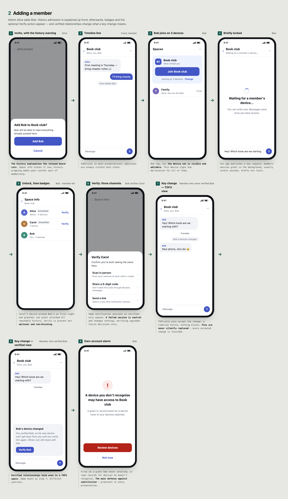

# PEEP UX Flows: TOFU

Informative. User-facing flows for spaces whose [verification policy](../core.md#device-verification-policy) is `tofu`. See also [Verified-only](verified-only.md) and [Relaxed TOFU](relaxed-tofu.md), which presents the same policy with minimal security UI. A "device" is an app installation.

## What protects these spaces

Devices are trusted on first use, and later unapproved changes are accepted as visible [TOFU key changes](../device-enrollment.md#local-trust). A malicious PDS can substitute keys; the defense is detection, through [auditing](../audit.md#direct-sync) of grants to your own account and notices of every unapproved change.

No one verifies devices in a TOFU space. Members share one key, so one member verifying another would not protect the space: anyone who accepted a substituted device could pass it the key ([why](../core.md#device-verification-policy)). Groups that want verification create a [verified-only](verified-only.md) space.

The policy is chosen at creation and [fixed for the life of the space](../core.md#device-verification-policy). Space info says: "Devices in this space aren't verified. Changes are shown, but not blocked."

## UI vocabulary

- **Space policy:** *Allow unverified devices* (the default).
- **Device list** per member: each device and when it was added. No trust badges and no Verify action, even for people you verified elsewhere.

## Creating a space

1. **"New space" form:** name, optional members, and *Allow unverified devices* / *Require verified devices*. The form says the choice is permanent: "You can't change this later. To change it, create a new space."
2. **No device choice.** Every device on the account can read every space the account belongs to ([approvals](../device-enrollment.md#approvals)), so creating asks nothing about devices.
   - *Under the hood:* the host stores configuration revision 1 and the creator's eligible membership decision. On the app's first PEEP use, it generates keypairs and publishes its [device record](../device-enrollment.md#bindings-and-publication).
3. **No extra wait.** The space key is generated on this device before the space is created, and its [commitment](../core.md#key-generation) is part of the creating configuration, so posting can start as soon as creation succeeds.
4. **Space opens.** The creator's other devices get the key when they open it; installations of the same app get it right away.

**Sole-holder indicator:** whenever this device is the only known holder of the space key (it has seen no grant of that key to any other binding), show a quiet note: "Only this device can currently read this space." It disappears once another device or member receives the key and links to "Add a device".

## Adding a member

Admin Alice adds Bob.

**Alice:**

1. **Invite Bob.** The confirmation explains that admission includes retained history: "Bob will be able to read everything already posted here." This is [recommended](../core.md#trusted-host-state), and space info also states it; a space has [one key](../core.md#key-generation), so past content is part of membership.
2. **Every member sees "Alice added Bob"** in the timeline.

**Bob:**

3. **Notification, then "Join Book club."** One tap, no device list. His other devices request the key when he opens the space on them.
4. **Brief locked state: "Waiting for a member's device…"** His app publishes a [key request](../core.md#key-requests). Bob can write drafts locally. Members' devices grant [in the background](#keeping-spaces-available), usually within seconds.
5. **Unlock.** Carol's device pins Bob's device on first sight and grants; Bob's device pins Carol's device and accepts. One grant unlocks all reachable history.

**Afterwards:**

6. **Device lists:** each sees the other's devices, with no badges or Verify action.
7. **Key changes:** if Bob's keys change without approval from a Bob device already pinned, every member accepts the change and sees a timeline notice: "Bob's devices changed." Nothing blocks, including for members who verified Bob for a verified-only space; there the change still blocks until he is re-verified. Pins are never silently replaced; every accepted change is recorded.
8. **Alarms:** Bob's client alarms if it finds a grant to a device he never approved, or records in his repo for devices he doesn't recognise ([auditing](../audit.md#direct-sync)): "A device you don't recognise may have access to *Book club*." These are the main defense against substitution, so they are prominent.

## Adding a device

Alice gets a new laptop.

1. **Laptop:** install, log in, show "Link this device" with a QR code. Generating keys and publishing the device record grants nothing on its own.
2. **Phone:** Devices → Link → scan, then one confirmation: "Link *Alice's Laptop*? It will be able to read all your spaces. Only link devices you own." The phone signs an [approval](../device-enrollment.md#approvals); there is no list of spaces.
3. **Pairing transfers [private state](../device-enrollment.md#backup-and-transfer):** pins (and any verifications, which only verified-only spaces use) move to the laptop so it does not pin everyone afresh, and [trust sync](../device-enrollment.md#own-device-trust-sync) keeps them current afterwards.
4. **Spaces open on demand.** When Alice opens a space on the laptop, it requests the key and her phone grants it in the background; the laptop reads full history. Installations of the same app may get keys right away.
5. **Other members:** the laptop is approved by Alice's phone, so they accept it. No timeline notice; device lists show "Alice · 3 devices".
6. **Alice's other devices notify her:** "New device: *Alice's Laptop*, added from *iPhone*, 2 minutes ago. Not you? Remove it." One notice per device, none on the approving phone. Removing it revokes the laptop, which then gets no new keys but keeps those it already received; the notice tells Alice to sign it out at her provider and change her password, which ends its access to spaces. A device Alice never approved means her account or PDS may be compromised, so this notice, unlike an ordinary device removal, also offers to move affected spaces ([own-account notices](../audit.md#direct-sync), [no rotation](../core.md#no-rotation)).

## Losing every device

1. **"Restore from backup"** (same keys and state) or **"Start fresh"**. There is currently no other [recovery process](../device-enrollment.md#total-device-loss).
2. **Starting fresh is cheap.** Members accept her new device as a [key change](../device-enrollment.md#local-trust) and see "Alice's devices changed." Alice's new device pins everyone again. She loses no protection she had at first contact. Verified-only spaces she belongs to need [re-verification](verified-only.md#losing-every-device).
3. **History mostly returns:** members re-grant keys they hold. Content is lost only where Alice's devices held the only copies.
4. Copy is honest: "Resetting your account password can't restore encrypted access."

## Creating a space from an existing space

PEEP has no parent/child relationship; each space is cryptographically independent. This is also how a group leaves a space it credibly believes is compromised beyond what the host can stop ([replacing a space](../core.md#replacing-a-space)); it is not a response to [removing a member](#removing-a-member-or-device).

| Carries over | Doesn't carry over |
| --- | --- |
| [Device trust](../device-enrollment.md#local-trust): TOFU pins, plus any verifications, which matter only if the new space is verified-only. | Membership: each admission is a separate host decision (the app can prefill it). |
| Public device records and approvals. | |
| | Keys and history: the new space has its own key; parent content is not readable through it. |
| | Policy: the app copies it by default, but a derived space is how a group changes policy. |

1. **"New space from Book club…"** prefills the parent's members and policy. Copy: "Members are copied; messages aren't." Offering *Require verified devices* here is how a group upgrades: the new space is [verified-only](verified-only.md#creating-a-space-from-an-existing-space), and members verify each other there.
2. **Creator:** as in [creating a space](#creating-a-space).
3. **Each member taps Join once;** existing pins carry over, so grants arrive as soon as their devices request them.

## Removing a member or device

1. **Removal stops new keys at once.** Removing Carol from Book club takes effect as soon as members' apps and the host learn of it: no new grants to her devices, and the host stops issuing her access. Access she already has expires within minutes, an hour at most ([ending access](../core.md#ending-access)). Nothing is held back; posting continues.
2. **Removing a device takes one more step.** Removing a lost device stops new keys, but the device can keep reading until its access is removed at the account's PDS, which the app can't do yet. The removal confirmation says: "To stop *Alice's Laptop* reading new messages, also sign it out in your account settings at your provider. If someone may know your password, change it." Once it is signed out, its access ends within minutes ([ending access](../core.md#ending-access)).
3. **Copy is honest.** The timeline says "Carol was removed," never that new messages are protected from her. Space info explains: "Carol's devices still hold this space's key. If she got new messages some other way, she could read them" ([no rotation](../core.md#no-rotation)).
4. **No move offered.** Removing, plus signing a device out, is the whole response; the notice does not suggest a new space. Moving lives in space settings for groups that credibly believe the space is compromised beyond what the host can stop ([replacing a space](../core.md#replacing-a-space)).

## Keeping spaces available

1. **Background issuing.** Key requests trigger push notifications to members' devices, which grant without the app being opened ([distribution](../core.md#distribution-scheduling)). On iOS, the visible "Bob joined Book club" notification's service extension does the work, which requires installation keys readable after first unlock ([platform notes](../device-enrollment.md#platform-notes)).
2. **Visible prompts.** If no grant arrives within a short window, the requester's app asks members to open the space: "Bob is waiting to join Book club. Open to share access."
3. **Always-on devices.** A desktop, home server, or hosted agent linked as an ordinary device grants whenever it is running. Settings copy: "Keep your spaces available from this computer." Hosted agents say who operates them, because they hold keys.

