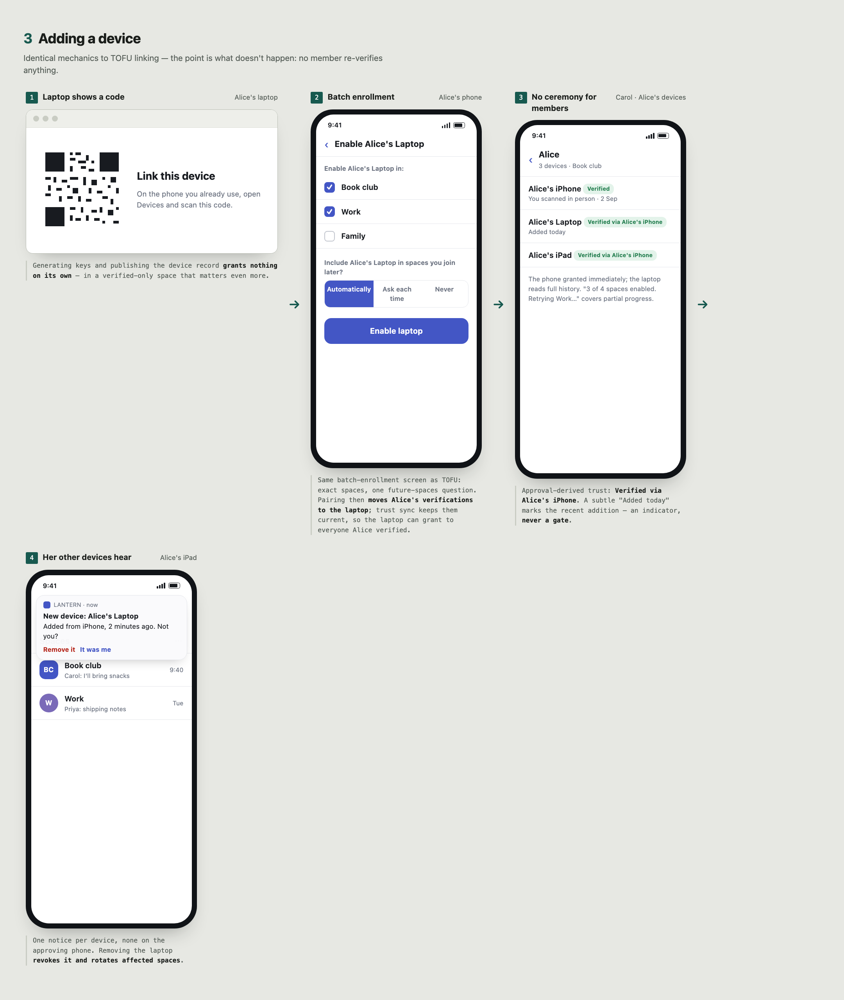
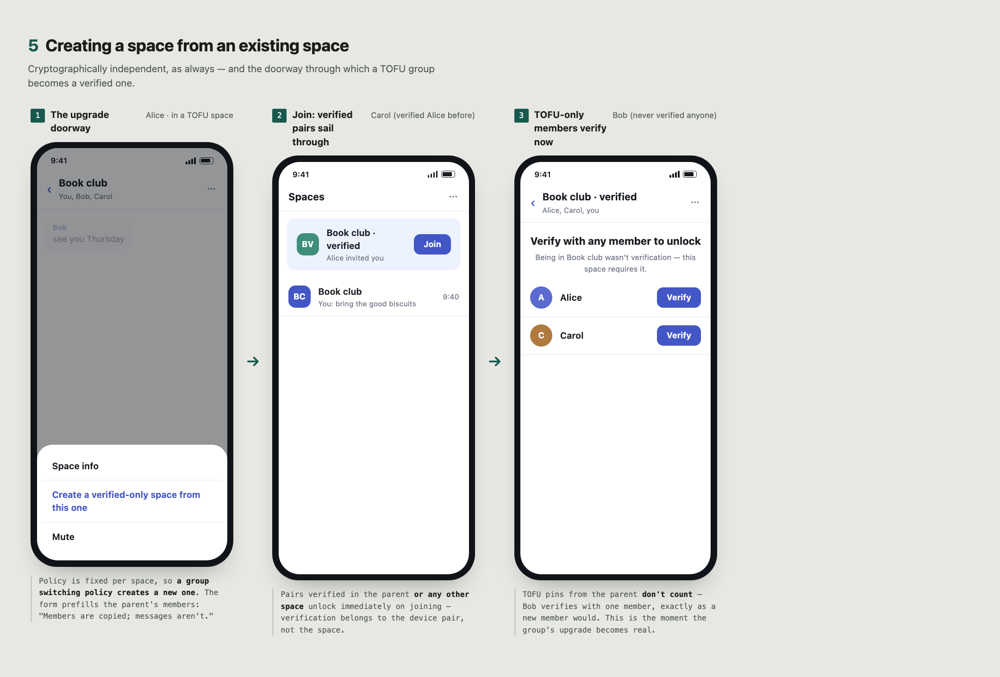
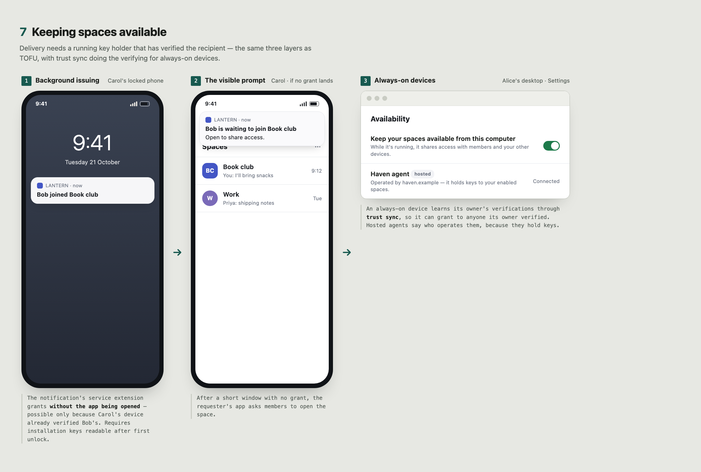

# PEEP UX Flows: Verified-only

Informative. User-facing flows for spaces whose [verification policy](../core.md#device-verification-policy) is `verified-only`. See also [TOFU](tofu.md) and [Relaxed TOFU](relaxed-tofu.md). A "device" is an app installation.

## What protects these spaces

Keys pass only between devices that have verified each other, directly or through same-account approval rooted in a verified device. A malicious PDS cannot substitute keys between verified devices. Because every exchange in the space requires verification, no member can hand the shared key to a substituted device through TOFU; that uniformity is what lets verification protect the whole space ([why](../core.md#device-verification-policy)). The cost is that every member verifies at least one other member once; verification is then reused across all verified-only spaces.

The policy is chosen at creation and [fixed for the life of the space](../core.md#device-verification-policy). Space info says: "Only verified devices can read this space."

## UI vocabulary

- **Space policy:** *Require verified devices*. A space that allows unverified devices is a different space; a group switching policy creates a new one.
- **Trust badge** per device: *Verified* or *Verified via \<their other device\>* (approval-derived). Unverified devices appear only as "Waiting for verification".
- **Verify:** one action with three channels: scan in person, share a 6-digit code, or send a link.

## Creating a space

1. **"New space" form:** name, optional members, and *Require verified devices*. The form says the choice is permanent: "You can't change this later. To change it, create a new space."
2. **No device choice.** Every device on the account can read every space the account belongs to ([approvals](../device-enrollment.md#approvals)), so creating asks nothing about devices.
   - *Under the hood:* the host stores configuration revision 1 and the creator's eligible membership decision. On the app's first PEEP use, it generates keypairs and publishes its [device record](../device-enrollment.md#bindings-and-publication).
3. **No extra wait.** The space key is generated on this device before the space is created, and its [commitment](../core.md#key-generation) is part of the creating configuration, so posting can start as soon as creation succeeds.
4. **Space opens.** The creator's other devices get the key when they open it, or right away for installations of the same app; they are verified through pairing.

**Sole-holder indicator:** whenever this device is the only known holder of the space key (it has seen no grant of that key to any other binding), show a quiet note: "Only this device can currently read this space." It disappears once another device or member receives the key and links to "Add a device".

## Adding a member

Admin Alice adds Bob.

**Alice:**

1. **Invite Bob.** The confirmation explains that admission includes retained history: "Bob will be able to read everything already posted here." This is [recommended](../core.md#trusted-host-state), and space info also states it; a space has [one key](../core.md#key-generation), so past content is part of membership.
2. **Verified invite (optional):** the invitation can open a [verification session](../device-enrollment.md#independent-verification) addressed to Bob and offer its 6-digit code or link to share through another app. Bob enters it when he joins, so inviting and verifying are one step.
3. **Every member sees "Alice added Bob"** in the timeline.

**Bob:**

4. **Notification, then "Join Book club."** One tap, no device list. His other devices request the key when he opens the space on them.
5. **Locked until verified: "Verify with any member to unlock,"** with the member list. The space name and members (host data) are visible; content is not. Bob can write drafts locally. If Bob already verified any member's device in another verified-only space, there is nothing to do: verification is reused.
6. **Members see "Bob is waiting. Verify Bob."** Any one member suffices, because every session verifies both directions. The admin has no special role.

**Verifying:**

7. **"Verify" offers three channels:**
   - **Scan in person:** one device shows a QR code, the other scans it. One scan; the shower's screen then reads "Bob's phone verified with you."
   - **Share a code:** "Verify Bob" shows a 6-digit PIN, valid for 15 minutes. Read it on a call or send it through another app. Bob's app shows "Alice wants to verify with you. Enter the code she gave you."
   - **Send a link:** the same session as a link, for sending through another app without a call.
8. **Copy rule:** "Don't send this code through Bluesky messages." Whoever sees the secret first can complete the session in Bob's place, and messages pass through the PDS this protects against.
9. **Failure is neutral and final.** A wrong PIN, a used link, or expiry ends that session: "Verification failed. This can happen if the code was mistyped or someone is interfering. Start a new verification." After repeated failures, the app recommends meeting to scan.
10. **Unlock.** With the session complete, the verifying member's device grants Bob the current key, which unlocks all reachable history. Other members' devices that verified Bob, directly or through [trust sync](../device-enrollment.md#own-device-trust-sync) from their owner's other devices, can also grant.

**Reuse:** verification belongs to a device pair, not a space. It extends through approvals: Bob's laptop, approved by his verified phone, shows as *Verified via Bob's phone*. In practice each pair of people verifies once.

**Key changes:** if Bob's keys change without approval from a verified Bob device, every member's client blocks: "Bob's device changed. Verify to continue." Grants to and from that device stop until Bob is re-verified or an approval resolves the [dispute](../device-enrollment.md#independent-verification). In TOFU spaces the same members accept the change with a notice, and their verification of Bob stays in effect here.

## Adding a device

Alice gets a new laptop.

1. **Laptop:** install, log in, show "Link this device" with a QR code. Generating keys and publishing the device record grants nothing on its own.
2. **Phone:** Devices → Link → scan, then one confirmation: "Link *Alice's Laptop*? It will be able to read all your spaces. Only link devices you own." The phone signs an [approval](../device-enrollment.md#approvals); there is no list of spaces.
3. **Pairing transfers [private state](../device-enrollment.md#backup-and-transfer):** Alice's verifications move to the laptop, and [trust sync](../device-enrollment.md#own-device-trust-sync) keeps them current afterwards. The laptop can grant to everyone Alice verified.
4. **Spaces open on demand.** When Alice opens a space on the laptop, it requests the key and her phone grants it in the background; the laptop reads full history. Installations of the same app may get keys right away.
5. **Other members need no ceremony.** Anyone who verified Alice's phone sees the laptop as *Verified via Alice's iPhone*. Device lists show "Alice · 3 devices"; apps may add a subtle indicator for a recent addition, never a gate.
6. **Alice's other devices notify her:** "New device: *Alice's Laptop*, added from *iPhone*, 2 minutes ago. Not you? Remove it." One notice per device, none on the approving phone. Removing it revokes the laptop, which then gets no new keys but keeps those it already received. A device Alice never approved means her account or PDS may be compromised, so this notice, unlike an ordinary device removal, also offers to move affected spaces ([own-account notices](../audit.md#direct-sync), [no rotation](../core.md#no-rotation)).

## Losing every device

1. **"Restore from backup"** (same keys and state) or **"Start fresh"**. There is currently no other [recovery process](../device-enrollment.md#total-device-loss).
2. **Starting fresh** means [re-verification](../device-enrollment.md#replacement): Alice and each member she exchanges keys with must verify again; one session per contact covers both directions. The new device lists those contacts and opens the sessions from a single screen. Contacts see "Alice has a new device that isn't linked to her old ones. Verify to share with her."
3. **History mostly returns:** members re-grant keys they hold. Content is lost only where Alice's devices held the only copies.
4. Copy is honest: "Resetting your account password can't restore encrypted access."

## Creating a space from an existing space

PEEP has no parent/child relationship; each space is cryptographically independent. This is also how a group leaves a space it credibly believes is compromised beyond what the host can stop ([replacing a space](../core.md#replacing-a-space)); it is not a response to [removing a member](#removing-a-member-or-device).

| Carries over | Doesn't carry over |
| --- | --- |
| [Device trust](../device-enrollment.md#local-trust): pairs verified anywhere stay verified. | Membership: each admission is a separate host decision (the app can prefill it). |
| Public device records and approvals. | |
| | Keys and history: the new space has its own key; parent content is not readable through it. |

1. **"New space from Book club…"** prefills the parent's members. Copy: "Members are copied; messages aren't." This is also how a TOFU group moves to verification: "Create a verified-only space from this one."
2. **Creator:** as in [creating a space](#creating-a-space).
3. **Each member taps Join once.** Pairs verified in the parent or any other verified-only space unlock immediately. Coming from a TOFU parent, TOFU pins don't count: each member verifies with one member, as for a new member.

## Removing a member or device

1. **Removal is immediate.** Removing Carol from Book club or removing a lost device takes effect as soon as members' apps and the host learn of it: Carol's devices get no new grants and the host stops serving her the space; posting continues.
2. **No move offered.** Removal is the whole response; the notice does not suggest a new space. Moving lives in space settings for groups that credibly believe the space is compromised beyond what the host can stop ([replacing a space](../core.md#replacing-a-space)).
3. **Copy is honest.** The timeline says "Carol was removed," never that new messages are protected from her, and space info explains that her devices still hold the key ([no rotation](../core.md#no-rotation)).

## Keeping spaces available

Delivery needs a running key holder that has verified the recipient.

1. **Background issuing.** Key requests trigger push notifications to members' devices, which grant without the app being opened ([distribution](../core.md#distribution-scheduling)). On iOS, a visible notification's service extension does the work, which requires installation keys readable after first unlock ([platform notes](../device-enrollment.md#platform-notes)).
2. **Visible prompts.** If no grant arrives within a short window, the requester's app asks members to open the space: "Bob is waiting to join Book club. Open to share access."
3. **Always-on devices.** A desktop, home server, or hosted agent linked as an ordinary device. It learns its owner's verifications through [trust sync](../device-enrollment.md#own-device-trust-sync), so it can grant to anyone its owner verified. Settings copy: "Keep your spaces available from this computer." Hosted agents say who operates them, because they hold keys.

